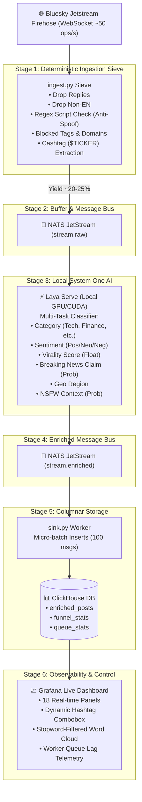

# Real-Time Social Stream Intelligence with Laya: Sub-Millisecond AI on the Bluesky Firehose

### How we processed 50+ posts/sec using Laya local inference instead of hosted models like Jev, combined with ClickHouse and Grafana.

---


*Photo by [Luke Chesser](https://unsplash.com) on Unsplash*

Every second, thousands of thoughts, breaking headlines, sports reactions, memes, and automated bots ripple across the decentralized social web. When Bluesky opened up its **Jetstream** firehose via public WebSockets, it offered developers a rare gift: unrestricted access to real-time public social discourse.

Naturally, the instinct for many modern developers is to plug this stream directly into a hosted LLM API:
```text
WebSocket → Python loop → OpenAI / Claude API → Database
```

If you’ve ever run that in production, you already know the punchline: **it will bankrupt you within 48 hours, saturate API rate limits in 30 seconds, and introduce 800ms of network latency per post.**

We wanted something fundamentally different:
1. **Sub-millisecond decisions running locally on-device** (zero external API dependencies, zero cloud egress costs).
2. **A deterministic pre-filtering sieve** that discards 75% of noise before compute resources are touched.
3. **Multi-task zero-shot classification** (Category, Sentiment, Virality, Breaking News Detection, Geo-Location, NSFW) in micro-batches on a single local GPU.
4. **Vectorized ClickHouse analytics** handling tokenization, stopword exclusion, cashtags, and rollups at millions of rows per second.
5. **A production-grade Grafana control plane** with zero lag, interactive drilldowns, and worker queue health telemetry.

Here is the architectural blueprint, the technical hurdles we hit, and the hard-won lessons learned building a real-time stream intelligence platform.

---

## 1. High-Level Architecture: The Zero-Hosted-API Philosophy

Our entire pipeline runs in Docker on commodity hardware. No hosted models, no external inference endpoints, and no cloud database dependencies.



---

## 2. Stage 1: The Deterministic Ingestion Sieve

The Bluesky Jetstream WebSocket outputs between 45 and 65 raw events per second. The first rule of high-throughput stream processing is simple: **never let garbage reach your machine learning models.**

In `ingest.py`, we implement a strict 3-tier deterministic sieve that executes in microseconds:

### A. Root Post Isolation
A huge portion of firehose volume consists of conversation replies, @mentions, and sub-thread commentary. For macro-level trend detection and breaking news sensing, we isolate root posts:
```python
def is_root_post(record: dict) -> bool:
    return "reply" not in record
```
*Drop rate: ~45–50% of the raw stream.*

### B. Adversarial Metadata Spoofing (The Japanese Kana Attack)
This was our first major battle. We initially filtered posts by declared language:
```python
if "en" not in record.get("langs", []):
    continue
```
To our surprise, hundreds of affiliate spam bots advertising adult manga and pirate websites flooded the dashboard. 

**Why?** Spammers deliberately spoofed AT Protocol metadata, declaring `langs: ["en"]` so Bluesky’s algorithms would syndicate their posts into English feeds, while the entire post body was written in Japanese!

Our fix was a microsecond regex consistency check on the raw text:
```python
RE_KANA = re.compile(r'[\u3040-\u309F\u30A0-\u30FF]')

def is_obscene_or_spam(record: dict) -> bool:
    text = record.get("text", "")
    # Drop immediately if Japanese scripts appear despite 'en' declaration
    if RE_KANA.search(text):
        return True
    ...
```
*Result: 100% of spoofed affiliate spam dropped at zero inference cost.*

### C. Regex-Driven Cashtag & Financial Ticker Extraction
Instead of asking an LLM to "extract stock entities" (a classic source of hallucinations and latency), we extract cashtags using a deterministic microsecond regex:
```python
RE_CASHTAG = re.compile(r'\$([A-Za-z]{1,6})\b')
cashtags = [f"${m.upper()}" for m in RE_CASHTAG.findall(text)]
```
Symbols like `$NVDA`, `$BTC`, `$TSLA`, and `$SPY` are normalized, placed into a typed array, and pushed to the message bus.

---

## 3. Stage 2 & 3: Local System One AI with Laya

Once the sieve runs, only high-signal, clean English root posts pass through (~10–15 msgs/sec). These are published to a NATS JetStream subject (`stream.raw`).

Here is where traditional architectures break down. Many System One pipelines default to hosted decision services like TypeSafe AI's **Jev** or 70B parameter generative LLMs to format JSON outputs. While Jev is powerful for programmable semantic judgments, routing high-throughput firehose streams (tens of thousands of calls an hour) through an external network boundary introduces HTTP transit latency, API billing, and vulnerability to outbound connection drops.

Instead, we use **Laya**, an ultra-fast, local, on-device decision engine designed for **purely local System One intelligence**. Rather than depending on remote APIs like Jev or generating slow autoregressive tokens, Laya runs entirely inside our own Docker container (`vinaybalamuru/laya:cuda`) directly on our local GPU. It acts as an embedded semantic router and classification engine, evaluating text at sub-millisecond speeds in micro-batches of 16 to 32.

### The Laya Declarative Schema: Multi-Task Zero-Shot Primitives

In Laya, you define judgments using structured System One primitives (`choice`, `score`, `noul`). Here is the exact production schema declared in [`inference.py`](file:///home/vinayb/CodeProjects/laya-fine-tune/inference.py):

```python
questions = {
    "category": {
        "type": "choice",
        "instructions": "What is the primary category of this post?",
        "criteria": {
            "tech": "technology, AI, programming, software",
            "politics": "government, elections, policy",
            "entertainment": "movies, music, pop culture",
            "finance": "markets, crypto, money",
            "lifestyle": "health, daily life, hobbies",
            "other": "everything else"
        }
    },
    "sentiment": {
        "type": "choice",
        "instructions": "What is the sentiment of this post?",
        "criteria": {
            "positive": "happy, excited, supportive",
            "negative": "angry, sad, critical",
            "neutral": "factual, objective, unopinionated"
        }
    },
    "virality": {
        "type": "score",
        "instructions": "How incendiary or viral is this post likely to be?",
        "criteria": ["mundane", "conversational", "incendiary and highly viral"]
    },
    "is_breaking_claim": {
        "type": "noul",
        "instructions": "Does this post make a verifiable factual claim or report breaking news?"
    },
    "geo_region": {
        "type": "choice",
        "instructions": "Which geographic region or continent does this post primarily reference or discuss?",
        "criteria": {
            "north_america": "United States, Canada, Mexico, North America",
            "europe": "UK, Germany, France, Ukraine, EU, Europe",
            "asia": "Japan, China, India, Korea, Taiwan, Asia",
            "middle_east": "Israel, Palestine, Gaza, Iran, Middle East",
            "latin_america": "Brazil, Argentina, Latin America, South America",
            "africa": "Nigeria, Kenya, South Africa, Africa",
            "oceania": "Australia, New Zealand",
            "global_none": "general, personal, online, or no specific geographic focus"
        }
    },
    "is_nsfw": {
        "type": "noul",
        "instructions": "Does this post contain sexually explicit, obscene, or adult NSFW material?"
    }
}
```

### The Asynchronous Micro-Batch Dispatcher

In [`inference.py`](file:///home/vinayb/CodeProjects/laya-fine-tune/inference.py), workers pull messages from NATS JetStream, package them into a vectorized batch, dispatch them to the local `laya-serve` daemon, and perform atomic ACK/NAK processing:

```python
async def process_batch(session: aiohttp.ClientSession, js, messages):
    states = [{"body": json.loads(m.data.decode()).get("commit", {}).get("record", {}).get("text", "")} for m in messages]
    payload = {"states": states, "questions": questions}

    # Dispatch micro-batch to local Laya HTTP daemon (sub-15ms on CUDA)
    async with session.post(f"{SYSTEM_ONE_URL}/v1/systemone/batch", json=payload) as resp:
        if resp.status == 200:
            results = await resp.json()
            for msg, laya_result in zip(messages, results.get("results", [])):
                data = json.loads(msg.data.decode())
                data["laya"] = laya_result  # Embed Laya's structured judgments
                await js.publish(ENRICHED_SUBJECT, json.dumps(data).encode())
                await msg.ack()              # Acknowledge delivery
        else:
            for msg in messages:
                await msg.nak()              # Trigger NATS redelivery on failure
```

### Why Local Laya Over Hosted Systems (like Jev):
* **True Local Execution**: Zero external API dependencies, zero cloud egress costs, and complete data privacy.
* **Predictable Micro-Batch Latency**: Laya evaluates all 6 dimensions concurrently in **under 15 milliseconds per batch** via local CUDA tensor cores.
* **Deterministic Throughput**: Immune to external rate limits or third-party outages during sudden firehose traffic spikes.
* **Guaranteed Typed Output Schema**: Eliminates parsing errors and schema drift at wire speed.

Subtle edge-cases that escape keyword blocklists (e.g., nuanced toxic slurs or adult innuendo) are caught downstream by Laya's `is_nsfw >= 0.5` scoring before ever being surfaced in the analytics store.

---

## 4. Stage 4 & 5: Vectorized Analytics with ClickHouse

Enriched posts land in NATS `stream.enriched`. The `sink.py` worker pulls micro-batches of 100 messages and writes them into ClickHouse using columnar array types:

```sql
CREATE TABLE IF NOT EXISTS bluesky.enriched_posts (
    id String,
    created_at DateTime,
    text String,
    author_did String,
    hashtags Array(String),
    cashtags Array(String),
    category String,
    sentiment String,
    virality Float32,
    is_breaking_claim Float32,
    geo_region LowCardinality(String),
    primary_lang LowCardinality(String),
    is_nsfw Float32 DEFAULT 0.0
) ENGINE = MergeTree()
ORDER BY (created_at, category, sentiment);
```

### In-Database Tokenization & Stopword Exclusion
We wanted an interactive **Keyword Cloud** per topic category. The typical approach involves shipping text over to Python, running NLTK or SpaCy lemmatizers, and inserting counts back into a table.

We avoided this entirely by leveraging ClickHouse’s native vectorized string functions:

```sql
SELECT
    word,
    count() AS freq
FROM bluesky.enriched_posts
ARRAY JOIN arrayFilter(
    w -> length(w) >= 3 
         AND match(w, '^[a-z]+$') 
         AND w NOT IN (
             'the', 'and', 'for', 'that', 'this', 'with', 'from', 'have',
             'just', 'like', 'about', 'what', 'when', 'your', 'they', 'will',
             'https', 'http', 'com', 'www', 'bsky', 'social'
         ),
    tokens(lower(text))
) AS word
WHERE $__timeFilter(created_at)
  AND is_nsfw < 0.5
  AND ${category_filter}
GROUP BY word
ORDER BY freq DESC
LIMIT 50;
```
This executes across tens of thousands of rows in **under 4 milliseconds**, reacting instantly when a user changes category filters in Grafana.

---

## 5. Stage 6: The Grafana Observability Control Plane

A backend data pipeline is only as good as its visibility. We provisioned an 18-panel real-time operational dashboard in Grafana configured with 5-second auto-refresh:

### 1. The 7-Stage Pipeline Funnel Audit
Rather than vague summaries, our funnel table provides exact mathematical attribution:
$$\text{Raw Firehose} = \text{Replies Drop} + \text{Non-EN Drop} + \text{Spam Drop} + \text{Passed to AI}$$

Every stage displays exact volume and percentage drop-off:
* **Stage 1: Raw Ingested** (~48.5 msgs/sec | 100%)
* **Stage 2: Filtered Replies** (~24.1 msgs/sec | -49.6%)
* **Stage 3: Filtered Non-English** (~12.8 msgs/sec | -26.3%)
* **Stage 4: Filtered Spam / Kana** (~0.8 msgs/sec | -1.6%)
* **Stage 5: Passed to Laya AI** (~10.8 msgs/sec | 22.5% yield)
* **Stage 6: Enriched in ClickHouse** (100% of passed)
* **Stage 7: Breaking Claims Radar** (~1.2% flagged with high urgency)

### 2. Real-Time Worker Lag & Queue Health
Using NATS JetStream API metrics logged to `bluesky.queue_stats` every 3 seconds, the dashboard charts consumer lag for the AI worker, database sink, and escalation alerts. If the GPU pipeline stutters, the backlog curve spikes immediately before data loss can occur.

### 3. Multi-Dimensional Drilldown & 1-Click Reset
Operators can slice and dice the firehose across 6 synchronized dimensions:
* **Geographic Region** (`North America`, `Europe`, `Asia`, etc.)
* **Category** (`Tech`, `Finance`, `Politics`, `Entertainment`, `Lifestyle`)
* **Sentiment** (`Positive`, `Neutral`, `Negative`)
* **Trending Hashtag** (Dynamically populated Top 50 combobox)
* **Custom Hashtag / Keyword Search** (Arbitrary regex & text matcher)
* **Account Activity Tier** (Separating casual humans from high-frequency news wires)
* **↺ Reset Filters to Default**: A single-click toolbar action that restores all baseline parameters without losing the active time zoom.

---

## 6. Key Lessons Learned

Building high-velocity streaming architectures always reveals subtle production traps. Here are our top takeaways:

### 1. Never Trust Edge Metadata
Clients and bots will lie about their language, client versions, and intent. If you rely on `post.langs == ["en"]`, spammers will exploit it. Always pair metadata with fast, deterministic content heuristics at your ingestion boundary.

### 2. Distributed Botnets Beat Rate Limiters
We observed spam campaigns operating across dozens of distinct Decentralized Identifiers (DIDs), each publishing just 8–10 posts per hour. If your spam strategy relies purely on `post_count > X/hr`, distributed Sybil networks will slip right past you. Content signatures and protocol-level label checks must come first.

### 3. Align Your Cross-Panel SQL Subqueries
In Grafana, if you have a "Top 10 Hashtags" panel next to a "Sentiment Breakdown for Top 10 Hashtags" stacked bar chart, never rank them with independent queries. Ingested posts without sentiment will cause the second query to pick a slightly different set of hashtags. Always nest the parent query inside the child’s `WHERE hashtag IN (...)` subclause.

### 4. Push Heavy Operations to the Vector Engine
Resist the urge to write custom Python daemons for word counting, tokenization, or time rollups. Modern columnar engines like ClickHouse execute array operations, regex matching, and text tokenization orders of magnitude faster and with zero serialization overhead.

### 5. System One AI is the Sweet Spot for Streaming
Generative models are great for conversational reasoning, but terrible for high-throughput stream enrichment. Compact, zero-shot System One models like Laya provide the semantic intelligence needed to understand tone, urgency, and category at native wire speed.

---

## Final Thoughts

Processing live internet streams shouldn't require thousands of dollars in cloud API bills or sprawling infrastructure clusters. By combining:
* **A fast deterministic sieve** at the WebSocket boundary,
* **Local System One AI (Laya)** on an on-premise accelerator,
* **Columnar vectorized storage (ClickHouse)**, and
* **Declarative observability (Grafana)**,

we built an engine that ingests, classifies, enriches, and visualizes the global pulse of Bluesky with sub-millisecond precision, complete data sovereignty, and zero cloud lock-in.

*The full stack is open source, packaged via Docker Compose, and ready to deploy on any local workstation.*
